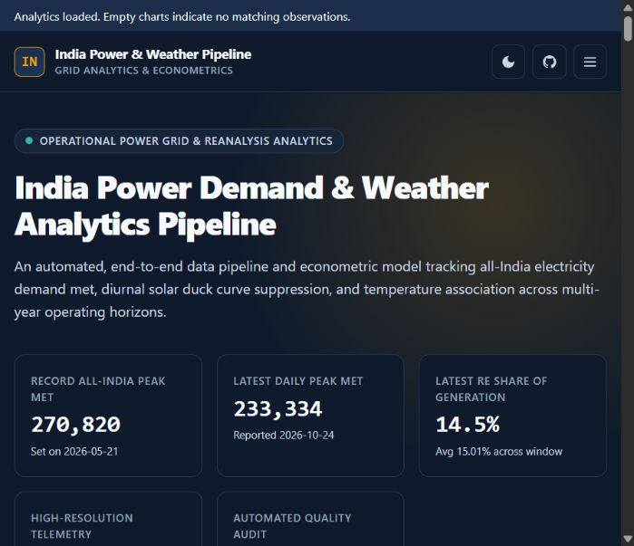
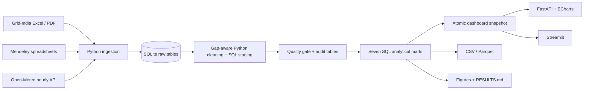

# India Power Demand & Weather Pipeline

[](https://github.com/randomaban-beep/india-power-demand-pipeline/actions/workflows/ci.yml)

A Python/SQLite pipeline for studying India's electricity demand, renewable generation,
and weather. It turns heterogeneous public Excel/PDF reports and hourly weather into
validated analytical tables, an interactive FastAPI/ECharts dashboard, and reproducible exports.

The engineering focus is **data integrity and reproducibility**: explicit missing values,
gap-aware telemetry cleaning, quality gates, repeatable SQL marts, and atomic snapshot publication.
This is a portfolio analytics system, not a real-time grid control or forecasting service.



## Run the dashboard

Requires Python **3.11**. Run commands from the repository root.

```bash
git clone https://github.com/randomaban-beep/india-power-demand-pipeline.git
cd india-power-demand-pipeline
python -m venv .venv
# Windows PowerShell: .\.venv\Scripts\Activate.ps1
# macOS/Linux: source .venv/bin/activate
python -m pip install -r requirements.txt
python -m uvicorn server.main:app --host 127.0.0.1 --port 8000
```

Open [the dashboard](http://localhost:8000) or [API documentation](http://localhost:8000/docs).
The committed `data/energy_marts.db` supports browsing without downloads or credentials.
ECharts is loaded from a pinned CDN URL and needs internet access. An optional alternative is
`python -m streamlit run app/streamlit_app.py`.

## Rebuild offline from real sample data

```bash
python -m scripts.load_sample --db data/sample.db
python -m src.pipeline --db data/sample.db --output data/run-sample
```

The loader refuses to overwrite an existing database. Rerun the second command freely.
The [attributed fixture](data/sample/README.md) contains 168 hourly demand observations,
1,008 city-weather records, two daily reports and 74 state records from 1–7 April 2024.
It exercises the actual cleaner, quality checks, all seven SQL marts and CSV/Parquet export.
It is a smoke-test sample, not sufficient data for regression conclusions. The correlation
check reports **SKIP**, rather than PASS, when fewer than ten overlapping days are available.

Outputs are `energy_marts.db`, `processed/*.csv`, `processed/*.parquet`, and `run.json`
in the chosen directory. The source database is preserved: the runner uses a SQLite backup,
fails on quality errors, and publishes the dashboard snapshot only after validation.
Exports are atomic per file, not a transaction across the entire output directory. Use separate
output directories for concurrent runs. The JSON report records stage times, row counts,
valid demand rows, a raw-data hash, and success or failure.

To view this sample, set `ENERGY_DB_PATH=data/run-sample/energy_marts.db` before starting
the server (PowerShell: `$env:ENERGY_DB_PATH='data/run-sample/energy_marts.db'`).

## Full historical data and live refresh

The full raw database is deliberately excluded from Git. Restore the existing rolling
GitHub Release asset with the GitHub CLI, then decompress it:

```bash
gh release download data-latest --repo randomaban-beep/india-power-demand-pipeline --pattern energy.db.gz --dir data
python -c "import gzip,shutil; s=gzip.open('data/energy.db.gz','rb'); d=open('data/energy.db','wb'); shutil.copyfileobj(s,d); d.close(); s.close()"
python -m src.pipeline --db data/energy.db --output data/run-full
# Optional public-source refresh on an isolated copy:
python -m src.pipeline --db data/energy.db --output data/run-live --ingest
```

The release is mutable; retain a local copy and the run's raw-data hash for repeatability.
Downloads depend on source availability. Grid-India failures may retain existing reports
and are recorded as errors; weather failures stop the run. A populated legacy Mendeley
archive is intentionally reused. New archive ingests record completed filenames so interrupted
runs can resume. The loader selects small spreadsheets and the 2024 multi-month report;
**it does not ingest every high-frequency source file**.

For an initial network bootstrap, explicitly set `ENERGY_DB_PATH=data/energy.db` and run
`python -m src.ingest.run_all`. Expect incomplete historical PSP coverage from the recent-report
window. The release restore or bundled offline fixture is the recommended reproducible start.

## Architecture



- **Ingestion:** public sources, bounded weather retries, schema validation, keyed upserts.
- **Cleaning:** conflicting duplicate and malformed timestamp rejection; missing values remain
  missing; stuck sensors, dip windows, night solar and wind thresholds are explicitly flagged.
- **Analytics:** seasonal profiles, monthly peaks, temperature associations, net load,
  consecutive-hour ramps and retrospective demand anomalies.
- **Serving:** read-only SQLite, parameterized filters, bounded caching, CSV downloads,
  date validation, readiness endpoint, visible loading/error feedback.
- **Why SQLite:** this national aggregate dataset fits on one machine; distributed infrastructure
  would add operational cost without a demonstrated need.

Key folders: `src/ingest`, `src/clean`, `src/model`, `sql`, `server`, `web`, `tests`, `scripts`.
See [source notes](docs/source_notes.md), [cleaning decisions](docs/cleaning_log.md),
[Power BI schema](docs/powerbi_model.md), [computed results](RESULTS.md), and
[engineering verification](docs/verification.md).

## Verification and measurements

```bash
python -m pytest -q --cov
python -m ruff check src server tests scripts
python -m ruff format --check src server tests scripts
python -m pip check
python -m scripts.benchmark --db data/energy.db --baseline-ref 5e86c18 --repeats 3
```

Tests include isolated cleaning and HTTP failure cases, API validation, SQL calendar semantics,
export rollback, Streamlit startup, and a real-sample integration test that rebuilds twice and
compares mart contents. Three full-database checks skip when that optional database is absent;
set `REQUIRE_FULL_DB=1` to require it. One downloaded-workbook check also skips
when its optional local file is absent. Tests do not refresh public APIs.

[Benchmark measurements](docs/benchmark.json) compare the original and revised cleaner on
identical raw input. Correctness fixes intentionally change which observations are flagged;
this is not a bit-identical optimization. Timing excludes downloads and is machine-specific.
No forecast accuracy, business savings, or production availability claims are made.

## Deployment

`Dockerfile` and `render.yaml` serve the committed snapshot. Set `ENERGY_DB_PATH` to an explicit
snapshot if a full database is also present. Readiness is `/api/ready`; `/api/health` shows stored
quality results and run history, not a guarantee that source data is current.

```bash
docker build -t india-power-pipeline .
docker run --rm -p 8000:8000 india-power-pipeline
```

Docker runtime verification requires a running Docker daemon. No live deployment is claimed.
Pull requests and pushes run `ci.yml`; `refresh.yml` runs at **02:00 UTC / 07:30 IST** and needs
the seeded `data-latest` release and repository write permission. Its freshness guard blocks
publication of excessively stale data. Refreshing figures and the report uses a full modeled
DB: `python -m src.viz.generate_all` and `python -m src.model.write_results`.

## Interpretation and limitations

- Historical telemetry has uneven coverage and two large gaps in the **selected extract**.
- Temperatures are an **unweighted six-city mean**, not national population-weighted exposure.
  Archive model selection is not pinned; recent weather can come from the forecast API.
- Hinge OLS is full-sample descriptive analysis. HC1 errors do not handle serial correlation;
  year dummies do not establish an economic or causal mechanism.
- Centered cleaning and full-sample anomaly baselines use future data. They must be redesigned
  before any leakage-safe forecasting experiment. No forecast model is claimed.
- Hourly renewable share uses demand; the official headline KPI uses gross generation.
  Daily and hourly demand series use different measurement definitions.
- Sensor thresholds are heuristics; largest remaining ramps are not independently validated.
- Future work: per-row weather provenance, archive completeness manifests for legacy data,
  stronger schema contracts and temporal validation if forecasting is added.

Code: [MIT](LICENSE). Source data retains its original attribution and terms.
