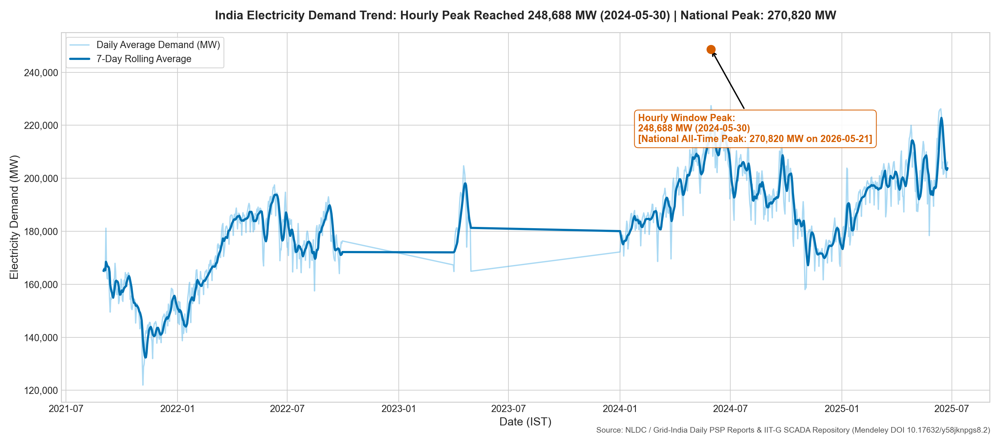
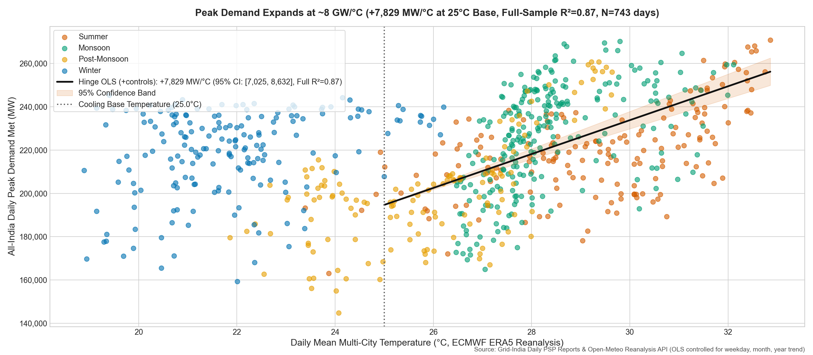
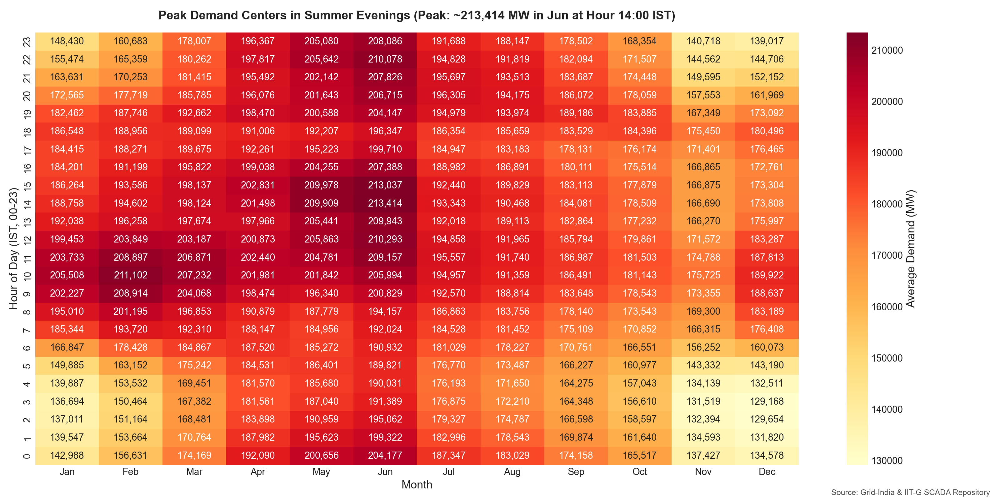
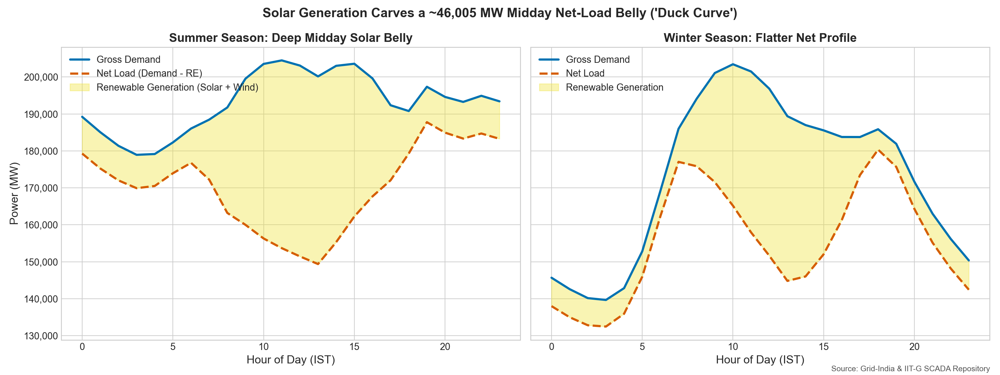
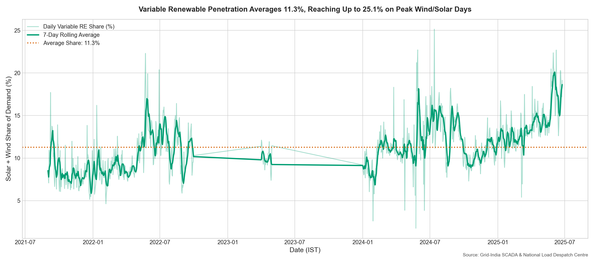
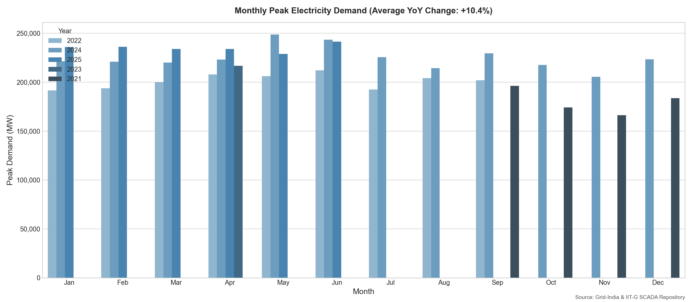
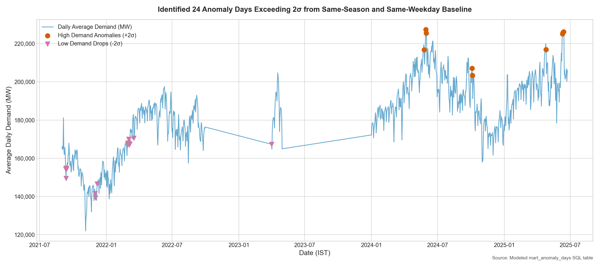
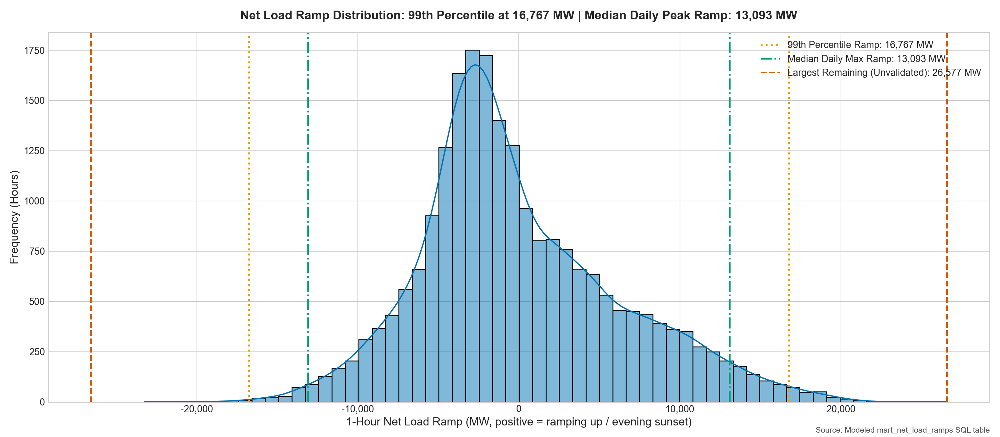
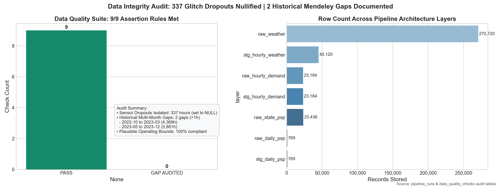

# India Power Demand & Weather Pipeline

[](https://github.com/randomaban-beep/india-power-demand-pipeline/actions/workflows/refresh.yml)
[](https://www.python.org/)
[](data/energy_marts.db)

An automated, end-to-end data engineering and analytics pipeline tracking India's electricity demand, fuel-wise generation, and weather variables across multi-year operating horizons. Ingests daily reports from Grid Controller of India (Grid-India / POSOCO), historical PMU / SCADA telemetry (Mendeley DOI: 10.17632/y58jknpgs8.2), and hourly ECMWF ERA5 reanalysis weather data; cleans and models data in SQLite; refreshes via GitHub Actions; and renders publication-ready visualisations and a custom responsive web application with FastAPI and Apache ECharts.

---

## ⚡ Executive Summary & Key Findings

> **Note on Data Synchronization:** All figures and metrics below are generated dynamically from `data/energy.db` via `src/model/write_results.py` and are identical to [`RESULTS.md`](RESULTS.md).

| Finding | Metric / Evidence | Strategic Takeaway ("So What") |
|---|---|---|
| **Controlled Temperature Elasticity** | **about 8 GW per °C** (+7,829 MW/°C at 25°C base, 95% CI: [7,025, 8,632] MW/°C, White's HC1 SE: 410.0 MW/°C; controls $R^2=0.7928$, full $R^2=0.8658$, incremental $\Delta R^2=+0.0730$ across 743 days; sensitivity across 22°C–28°C spans 6.0 GW to 10.1 GW) | Controlling for day-of-week, calendar month, and multi-year economic trend, every 1°C increase above 25°C adds about 8 GW of national peak cooling demand. Temperature accounts for an incremental +0.0730 of variance beyond seasonal/trend controls. |
| **Midday Solar Suppression** | **~46,005 MW** midday solar belly depth | Midday net load is significantly depressed during summer months, requiring steep thermal ramp-downs followed by aggressive evening ramp-ups. |
| **Grid Ramping Stress** | **16,768 MW** 99th percentile 1-hour ramp; **13,093 MW** median daily peak ramp | Solar sunset coinciding with evening industrial and domestic peak creates predictable tail ramping stress; largest remaining 1-hour ramp is **26,577 MW** (not independently validated). |
| **Renewable Penetration** | **11.1%** average daily share of electricity demand (peaking at **22.4%** on 2025-05-31) | Cross-validated against official Grid-India daily reports (share of generation, peaking at 21.9% on the exact same date; Pearson $r = 0.9875$, mean difference -0.36%). Solar and wind generation are actively reshaping the diurnal load curve across all five regional grids. |
| **Peak Demand Benchmark** | **248,688 MW** in hourly dataset window (2024-05-30) | Highest demand met recorded among loaded Grid-India daily reports reached **270,820 MW** (2026-05-21). |
| **Data Quality & Telemetry Audit** | **918 unique hours with any NULL** in demand, solar, or wind (including 337 glitch hours and 177 multi-hour dips); **2 historical gaps audited** | High-frequency telemetry spans 966 days (2021: 122, 2022: 273, 2023: 30, 2024: 366, 2025: 175); 2 documented multi-month gaps in the historical archive; dropouts, multi-hour dips, and flatlined sensors were isolated and set to `NULL` (never silently interpolated). |

---

## 📊 Core Visual Findings

### 1. Daily Demand Growth and Seasonality
Continuous time-series tracking daily average demand, 7-day rolling baseline, and dataset peak demand.

*Takeaway: Demonstrates persistent summer peak escalation (reaching 248,688 MW in the hourly dataset and 270,820 MW in loaded national daily reports) contrasted with winter base troughs (~104,310 MW).*

---

### 2. Controlled Temperature Sensitivity of Electricity Demand
Daily peak demand regressed against multi-city daily mean temperature, with categorical controls for weekday, month, and year trend.

*Takeaway: Daily peak demand expands at about 8 GW per °C (+7,829 MW/°C at 25.0°C base, 95% CI: [7,025, 8,632] MW/°C, White's HC1 SE: 410.0 MW/°C, full model $R^2=0.8658$, incremental $\Delta R^2=+0.0730$, $N=743$ observations) above the 25.0°C cooling base.*

#### Candidate Threshold Sensitivity Analysis (22°C to 28°C)

Evaluated on the same full sample of 743 daily observations using an OLS regression with a hinge term $\max(T - T^*, 0)$ and categorical controls for day-of-week, calendar month, and multi-year economic trend:

| Threshold (°C) | Days $\ge T$ ($N$) | Observations ($N$) | Slope (MW/°C) | White's HC1 SE | 95% Confidence Interval | Controls $R^2$ | Full $R^2$ | Incremental $\Delta R^2$ | AIC |
|---|---|---|---|---|---|---|---|---|---|
| **22.0°C** | 638 | 743 | +5,977.0 | 430.7 | [5,132.9, 6,821.1] | 0.7928 | 0.8476 | **+0.0547** | 13,644.8 |
| **23.0°C** | 593 | 743 | +6,486.9 | 429.1 | [5,645.8, 7,328.0] | 0.7928 | 0.8531 | **+0.0603** | 13,617.4 |
| **24.0°C** | 548 | 743 | +7,102.4 | 420.6 | [6,278.0, 7,926.8] | 0.7928 | 0.8589 | **+0.0661** | 13,587.5 |
| **25.0°C** **(Selected Base)** | 519 | 743 | +7,828.7 | 410.0 | [7,025.2, 8,632.3] | 0.7928 | 0.8658 | **+0.0730** | 13,550.2 |
| **26.0°C** | 481 | 743 | +8,495.8 | 391.5 | [7,728.4, 9,263.2] | 0.7928 | 0.8706 | **+0.0777** | 13,523.4 |
| **27.0°C** | 415 | 743 | +9,304.5 | 401.7 | [8,517.1, 10,092.0] | 0.7928 | 0.8705 | **+0.0777** | 13,523.6 |
| **28.0°C** | 274 | 743 | +10,064.1 | 449.6 | [9,182.8, 10,945.4] | 0.7928 | 0.8586 | **+0.0658** | 13,588.9 |


---

### 3. Diurnal Peak Load by Month
Heatmap of average hourly demand across hours of the day (IST) and calendar months.

*Takeaway: Grid strain concentrates heavily in evening peak hours (19:00–22:00 IST) during pre-monsoon summer months (April–June).*

---

### 4. Diurnal Net Load Profile ("Duck Curve")
Net load profile by season: gross demand, solar and wind generation, and net load.

*Takeaway: Midday solar generation suppresses net load by ~46,005 MW during peak summer solar hours, creating steep ramp requirements at dusk.*

---

### 5. Renewable Generation Share & Generation Mix
Daily renewable energy share distribution and generation breakdown by technology.

*Takeaway: Intermittent renewables account for an average of 11.1% of electricity demand, reaching a recorded daily peak of 22.4% of demand (cross-validated against official Grid-India generation reports, $r = 0.9875$).*

---

### 6. Monthly Peak Demand Growth
Year-over-year peak demand comparison across calendar months.

*Takeaway: Quantifies steady year-on-year electrification growth and rising cooling intensity across peak summer seasons.*

---

### 7. Demand Anomaly Detection
Identification of statistically anomalous grid demand days exceeding $\pm 2\sigma$ from same-season and same-weekday norms.

*Takeaway: Identified 24 real demand anomaly days cleanly separated from data-quality sensor dropout and flatline days.*

---

### 8. Hourly Net Load Ramp Distribution
Histogram of hour-to-hour net load changes computed strictly between consecutive non-glitch hours exactly 1 hour apart.

*Takeaway: 99th percentile 1-hour ramp is 16,768 MW, with a median daily maximum ramp of 13,093 MW (largest remaining 1-hour ramp: 26,577 MW, not independently validated). Telemetry flatlines, multi-hour dips, and unfreeze spikes that previously reported fake 80,000+ MW ramps have been filtered and isolated.*

#### Largest Remaining Ramps (Not Independently Validated, Flagged for Manual Review)

| Timestamp (IST) | Demand (MW) | Solar (MW) | Wind (MW) | Net Load (MW) | 1-Hour Ramp (MW) | Grid-India Daily Peak Met (MW) |
|---|---|---|---|---|---|---|
| `2024-01-27T07:00` | 195,828 | 2,243 | 10,085 | 183,500 | +26,577 | 219,550 |
| `2025-01-21T17:00` | 199,637 | 8,472 | 2,608 | 188,557 | +25,329 | 226,044 |
| `2025-01-20T07:00` | 203,719 | 2,888 | 4,469 | 196,362 | +23,794 | 222,178 |
| `2024-01-30T12:00` | 193,152 | 34,864 | 861 | 157,427 | -23,229 | 219,094 |
| `2025-05-06T16:00` | 196,770 | 27,116 | 8,709 | 160,945 | +22,940 | 202,394 |
| `2025-01-13T07:00` | 198,424 | 1,911 | 10,859 | 185,654 | +21,772 | 220,650 |
| `2025-01-24T06:00` | 187,239 | 110 | 12,183 | 174,946 | +21,393 | 231,215 |
| `2025-01-28T15:00` | 212,517 | 32,190 | 2,244 | 178,083 | +21,336 | 234,950 |
| `2025-01-21T06:00` | 184,326 | 139 | 5,668 | 178,519 | +21,195 | 226,044 |
| `2025-01-06T07:00` | 199,238 | 3,066 | 10,185 | 185,988 | +21,145 | 223,964 |
| `2024-12-19T06:00` | 181,023 | 299 | 5,956 | 174,769 | +21,015 | 219,721 |
| `2025-01-22T06:00` | 186,839 | 184 | 6,773 | 179,881 | +20,922 | 228,085 |
| `2025-01-07T06:00` | 182,418 | 213 | 11,454 | 170,751 | +20,797 | 228,072 |
| `2024-12-18T06:00` | 178,890 | 356 | 7,732 | 170,802 | +20,781 | 217,753 |
| `2025-01-06T06:00` | 175,987 | 641 | 10,503 | 164,843 | +20,581 | 223,964 |
| `2025-01-15T07:00` | 190,680 | 2,055 | 11,028 | 177,598 | +20,542 | 216,777 |
| `2022-05-06T15:00` | 172,503 | 23,446 | 4,792 | 144,265 | -20,492 | 199,773 |
| `2025-01-18T07:00` | 199,876 | 2,516 | 8,229 | 189,131 | +20,440 | 225,118 |
| `2025-01-29T06:00` | 193,557 | 270 | 6,001 | 187,286 | +20,431 | 237,309 |
| `2025-01-27T06:00` | 179,649 | 275 | 3,564 | 175,809 | +20,362 | 230,451 |
| `2025-01-24T07:00` | 209,896 | 2,850 | 11,812 | 195,235 | +20,290 | 231,215 |
| `2025-01-13T06:00` | 175,325 | 232 | 11,212 | 163,882 | +20,284 | 220,650 |
| `2022-03-09T01:00` | 136,384 | 0 | 7,620 | 128,763 | -20,251 | 192,026 |
| `2025-01-27T07:00` | 203,595 | 3,472 | 4,096 | 196,027 | +20,218 | 230,451 |
| `2025-01-30T06:00` | 191,596 | 171 | 6,473 | 184,953 | +20,212 | 234,525 |
| `2025-01-28T06:00` | 190,398 | 100 | 4,078 | 186,221 | +20,160 | 234,950 |
| `2025-01-07T07:00` | 204,467 | 2,577 | 11,033 | 190,856 | +20,106 | 228,072 |
| `2024-01-09T07:00` | 191,230 | 975 | 9,421 | 180,834 | +20,053 | 207,039 |
| `2024-12-20T06:00` | 182,141 | 317 | 10,767 | 171,058 | +20,027 | 224,169 |
| `2025-01-16T07:00` | 194,095 | 2,304 | 10,130 | 181,661 | +20,018 | 220,355 |


---

### 9. Pipeline Reliability and Data Completeness
Automated data quality assertion suite, records per architectural layer, and gap audit summary.

*Takeaway: Automated assertion suite verifies data cleaning and independent cross-validation. The 2 documented historical multi-month gaps in the Mendeley dataset (longest: 5,881h) and 337 sensor glitches are audited and reported with complete transparency.*

---

## 🏗️ Architecture

```
                    SOURCES
   ┌───────────────────┬───────────────────┬───────────────────┐
   │ Grid-India (NLDC) │ Mendeley Data     │ Open-Meteo API    │
   │ Daily PSP (.xls)  │ Hourly SCADA      │ ERA5 Reanalysis   │
   └─────────┬─────────┴─────────┬─────────┴─────────┬─────────┘
             │                   │                   │
             ▼                   ▼                   ▼
     ┌─────────────────────────────────────────────────────────┐
     │                      INGEST LAYER                       │
     │   src/ingest/grid_india.py   src/ingest/mendeley.py    │
     │              src/ingest/open_meteo.py                   │
     └───────────────────────────┬─────────────────────────────┘
                                 │
                                 ▼
     ┌─────────────────────────────────────────────────────────┐
     │                     RAW SQLITE DB                       │
     │  raw_daily_psp | raw_state_psp | raw_hourly | raw_weather│
     └───────────────────────────┬─────────────────────────────┘
                                 │
                                 ▼
     ┌─────────────────────────────────────────────────────────┐
     │                     STAGING LAYER                       │
     │  stg_hourly_demand  stg_hourly_weather  stg_daily_psp   │
     │       Automated DQ Assertions (src/clean/quality_checks) │
     └───────────────────────────┬─────────────────────────────┘
                                 │
                                 ▼
     ┌─────────────────────────────────────────────────────────┐
     │                     MODELED MARTS                       │
     │  mart_temp_vs_demand        mart_net_load_profile       │
     │  mart_daily_weather_demand  mart_monthly_peak_demand    │
     │  mart_net_load_ramps        mart_demand_profile_by_season
     │  mart_anomaly_days                                      │
     └───────────────────────────┬─────────────────────────────┘
                                 │
                    ┌────────────┴────────────┐
                    ▼                         ▼
         ┌─────────────────────┐   ┌─────────────────────┐
         │ STATIC FIGURES      │   │ STREAMLIT DASHBOARD │
         │ docs/figures/*.png  │   │ app/streamlit_app.py│
         └─────────────────────┘   └─────────────────────┘
```

---

## 💾 Data Sources & Licenses

| Source | Description | Coverage Span | License / Terms |
|---|---|---|---|
| [Grid Controller of India (Grid-India / POSOCO)](https://grid-india.in/en/reports/daily-psp-report) | Daily PSP Reports (generation by source, peak demand met, state demand) | 2021-05-07 to 2026-10-24 (769 reports: 2021: 52, 2022: 83, 2023: 77, 2024: 88, 2025: 172, 2026: 297)* | Public Indian government data |
| [Mendeley Data Repository (DOI: 10.17632/y58jknpgs8.2)](https://doi.org/10.17632/y58jknpgs8.2) | Hourly aggregated PMU / SCADA telemetry for demand, solar, and wind generation | 2021-09-01 to 2025-06-24 (23,184 hours across 966 days: 2021: 122, 2022: 273, 2023: 30, 2024: 366, 2025: 175) | CC BY 4.0 (Attribution 4.0 International) |
| [Open-Meteo Historical Archive & Forecast API](https://open-meteo.com/) | Hourly ECMWF ERA5 reanalysis temperature, humidity, wind across 6 cities | 2021-09-01 to Present (yesterday) | Free for non-commercial open data science |

> *\*Note on Daily PSP Coverage (API Listed vs Parsed):* API listed vs Parsed in DB — 2021: 364 listed (0 xls, 364 pdf) vs 52 parsed; 2022: 366 listed (0 xls, 366 pdf) vs 83 parsed; 2023: 730 listed (364 xls, 366 pdf) vs 77 parsed; 2024: 740 listed (370 xls, 370 pdf) vs 88 parsed; 2025: 729 listed (364 xls, 365 pdf) vs 172 parsed; 2026: 598 listed (300 xls, 298 pdf) vs 297 parsed. Actual cause of sparser early coverage: In 2021 and 2022, Grid-India published daily PSP reports exclusively as PDFs (0 Excel spreadsheets), whereas starting in 2023 each reporting day published dual formats (Excel .xls and PDF). The routine ingest job filtered solely for .xls spreadsheets, skipping PDF files, while initial historical backfill applied strided sampling. With the existing PDF parser integrated into ingest, PDF reports are parsed directly.
> *Note on Weather Data:* Open-Meteo provides atmospheric data via ECMWF ERA5 numerical model reanalysis simulations, rather than physical surface weather station observations.
> *Note on Historical Telemetry:* The Mendeley historical archive repository contains 2 documented multi-month gaps between high-resolution logging campaigns (2022-10 to 2023-03 and 2023-05 to 2023-12). These are documented in [`docs/source_notes.md`](docs/source_notes.md) and tracked in [`RESULTS.md`](RESULTS.md).

---

## 🚀 How to Run Locally

### 1. Clone & Set Up Environment
```bash
git clone https://github.com/randomaban-beep/india-power-demand-pipeline.git
cd india-power-demand-pipeline

python -m venv .venv
# Windows:
.venv\Scripts\activate
# Linux/Mac:
source .venv/bin/activate

pip install -r requirements.txt
```

### 2. Run Pipeline End-to-End
```bash
# 1. Ingest raw sources
python -m src.ingest.run_all

# 2. Clean and run data quality checks
python -m src.clean.run_all

# 3. Build SQL analytical data marts
python -m src.model.run_all

# 4. Generate all 9 publication figures
python -m src.viz.generate_all

# 5. Export summary reports (RESULTS.md and README.md)
python -m src.model.write_results

# 6. Run test suite
pytest tests/ -v
```

### 3. Launch Custom Web Application & API
```bash
uvicorn server.main:app --reload --port 8000
```
Open [http://localhost:8000](http://localhost:8000) in your browser. Interactive Swagger API documentation is available at [http://localhost:8000/docs](http://localhost:8000/docs).

---

## 🌐 Live Website & Cloud Deployment

- **Live URL:** `https://india-power-demand-pipeline.onrender.com` *(Deployment URL placeholder)*
- **Interactive API Docs:** `https://india-power-demand-pipeline.onrender.com/docs`

### Cloud Deployment (Render / Docker)
The application includes a production-ready `Dockerfile` and `render.yaml` for automated deployment on Render's free tier:
1. Connect this repository to [Render](https://render.com).
2. Create a **Web Service** selecting this repository.
3. Render automatically detects `render.yaml` and deploys with:
   - Build Command: `pip install -r requirements.txt`
   - Start Command: `uvicorn server.main:app --host 0.0.0.0 --port $PORT`

Alternatively, run with Docker locally:
```bash
docker build -t india-power-pipeline .
docker run -p 8000:8000 india-power-pipeline
```

---

## 🔌 API Endpoints Reference

All analytical endpoints accept optional parameters: `?from=YYYY-MM-DD&to=YYYY-MM-DD&seasons=Summer,Winter`.

| Endpoint | Method | Description | Source Mart / Model |
|---|---|---|---|
| `/api/summary` | `GET` | Headline operational KPIs (latest/record peak, RE share, record counts, audit status) | `stg_daily_psp`, `mart_temp_vs_demand`, `pipeline_runs` |
| `/api/daily-demand` | `GET` | Daily average and peak demand met with 7-day rolling baseline | `mart_anomaly_days` |
| `/api/monthly-peaks` | `GET` | Monthly peak demand escalation and year-over-year percentage growth | `mart_monthly_peak_demand` |
| `/api/temp-demand` | `GET` | Hourly temperature vs demand response with median 1°C bins (`?feature=avg_temperature_c\|delhi_temp_c\|mumbai_temp_c`) | `mart_temp_vs_demand` |
| `/api/heatmap` | `GET` | 12×24 matrix of average demand across calendar months and diurnal hours | `mart_temp_vs_demand` |
| `/api/sensitivity` | `GET` | Full-sample hinge OLS cooling sensitivity model parameters, robust HC1 SEs, and candidate thresholds | `compute_temperature_sensitivity()` |
| `/api/duck-curve` | `GET` | Diurnal generation profile (demand, solar, wind, net load) and dusk ramping metrics (`?season=All\|Summer\|...`) | `mart_net_load_profile` |
| `/api/re-share` | `GET` | Monthly average renewable penetration share and capacity breakdown | `mart_net_load_profile` |
| `/api/anomalies` | `GET` | Daily z-score series segmented by real demand outliers (±2σ) and isolated data glitches | `mart_anomaly_days` |
| `/api/ramps` | `GET` | Top 10 one-hour net-load ramping stress events cross-checked with Grid-India daily peak met | `mart_net_load_ramps`, `stg_daily_psp` |
| `/api/health` | `GET` | Automated data quality assertions, pipeline execution audit log, and database table volume | `data_quality_checks`, `pipeline_runs` |
| `/api/export/{name}.csv` | `GET` | Parameterised CSV streaming download for analytical marts (`daily-demand`, `anomalies`, `ramps`, `monthly-peaks`) | `server/queries.py` |
